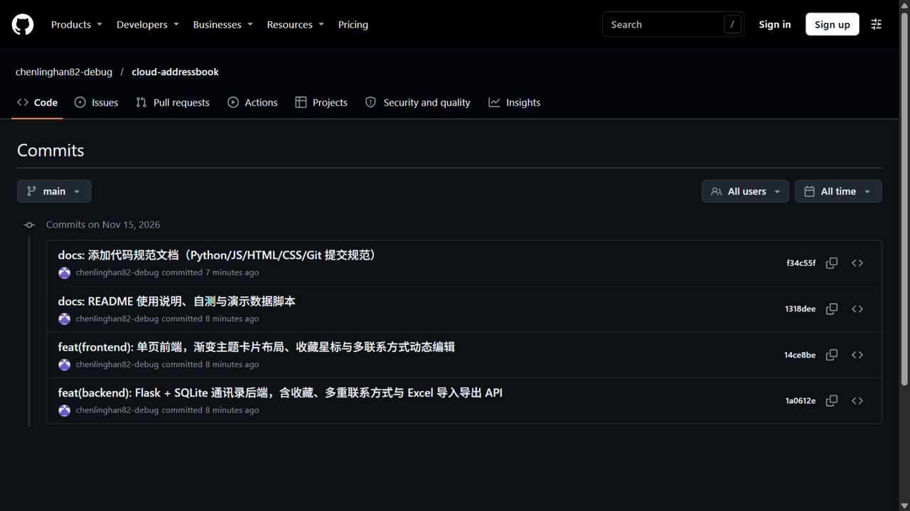
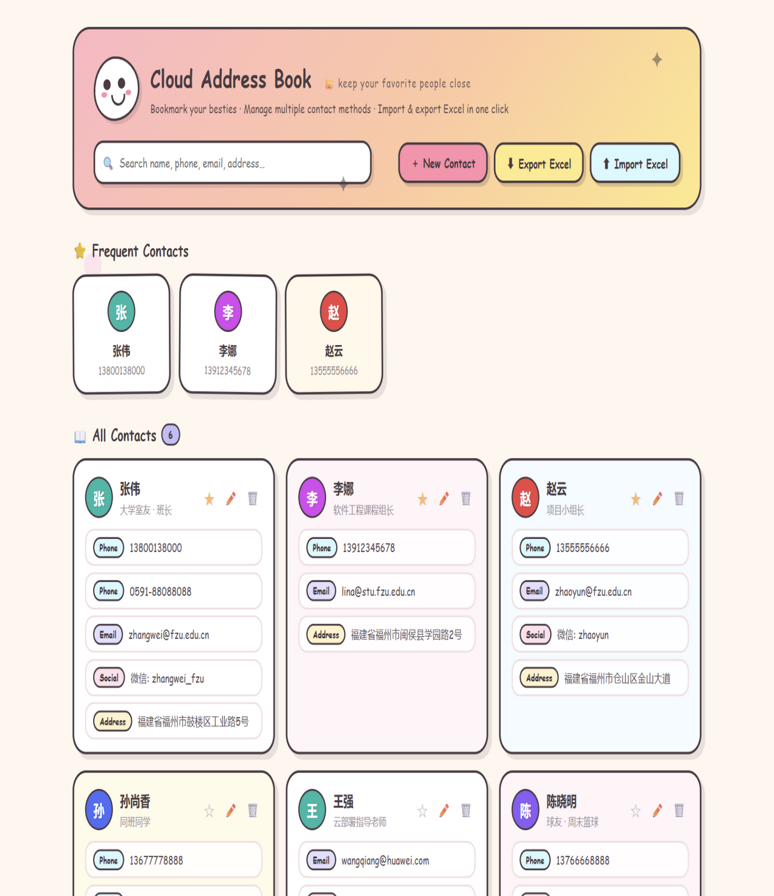
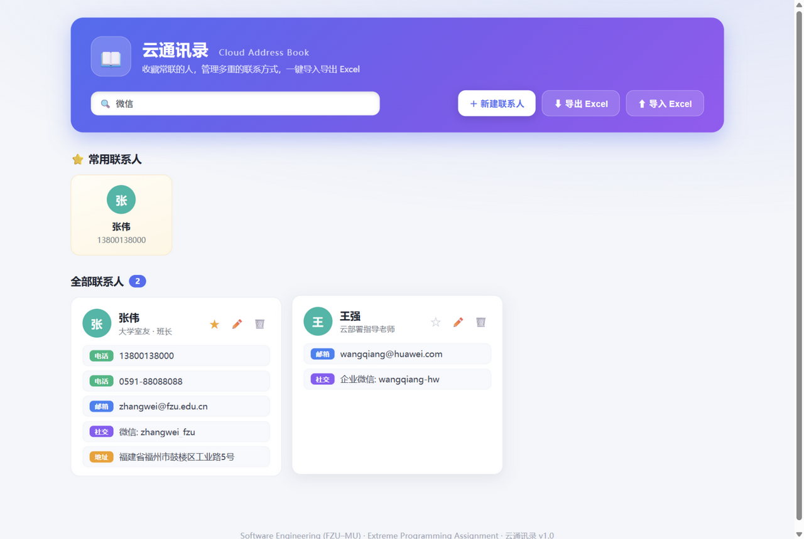

# 极限编程作业：云通讯录（收藏联系人 · 多重联系方式 · Excel 导入导出）

> 本篇博客为个人完成项目，记录从需求分析、设计、编码到测试的完整过程。

| 项目 | 内容 |
| --- | --- |
| 课程（作业所属课程） | Software Engineering (FZU–MU) |
| 队名 | 个人完成（无队名） |
| 作业要求链接 | [Extreme Programming(Deadline: November 17, 2026, 23:59)](https://bbs.csdn.net/topics/620593436) |
| 本次作业目标 | 实现一个支持**收藏联系人**、**多重联系方式**、**Excel 导入导出**的 Web 通讯录，体验完整的极限编程开发流程：设计 → 编码 → 测试 → 部署 → 博客复盘 |
| 其他参考 | [PEP 8 Python 代码风格指南](https://peps.python.org/pep-0008/)、[Flask 官方文档](https://flask.palletsprojects.com/)、[openpyxl 官方文档](https://openpyxl.readthedocs.io/) |

---

## 目录

<!-- CSDN 会自动根据标题生成目录 -->

## 一、项目地址

| 项目 | 链接 |
| --- | --- |
| GitHub 仓库 | https://github.com/chenlinghan82-debug/cloud-addressbook |
| 代码规范 | https://github.com/chenlinghan82-debug/cloud-addressbook/blob/master/docs/CODE_STANDARD.md |
| 本地访问地址 | `http://127.0.0.1:5000` |
| 演示视频 | 见第七节（完整运行视频） |

## 二、GitHub 提交历史



开发阶段共 **4 次**提交（见上方截图）；博客成稿时又将运行截图、演示视频与博客草稿补充入库 2 次，仓库累计 6 次提交，**全部由本人完成（贡献比例：本人 100%）**：

| 提交 | 内容 |
| --- | --- |
| `feat(backend)` | Flask + SQLite 通讯录后端，含收藏、多重联系方式与 Excel 导入导出 API |
| `feat(frontend)` | 单页前端，渐变主题卡片布局、收藏星标与多联系方式动态编辑 |
| `docs` | README 使用说明、自测与演示数据脚本 |
| `docs` | 添加代码规范文档 |
| `docs(blog)` ×2 | 运行截图、演示视频与博客草稿入库 |

## 三、需求分析与技术选型

### 3.1 作业功能拆解

| 功能 | 分值 | 我的实现 |
| --- | --- | --- |
| 收藏联系人 | 25 分 | 联系人卡片上的星标收藏，收藏后进入顶部"⭐ 常用联系人"快捷区，一键直达 |
| 多重联系方式 | 10 分 | 每个联系人可挂任意多条 电话 / 邮箱 / 社交媒体 / 地址，编辑弹窗内动态增删 |
| 导入导出 | 25 分 | 导出 Excel：每个联系人一行、每类信息一列（列数按最多条数自动扩展）；导入 Excel：按表头关键字自动识别，逐行入库 |
| 页面样式 | 10 分 | 渐变主题、卡片化布局、头像配色、响应式适配 |
| 云端部署（可选） | 15 分 | 见第八节说明 |

### 3.2 技术选型

- **后端**：Python Flask + SQLite。理由：轻量、零配置、单人开发效率高，SQLite 天然支持 `ON DELETE CASCADE` 级联删除联系方式。
- **Excel 处理**：openpyxl，可直接控制表头样式与列宽，导出的文件"人话可读"。
- **前端**：原生 HTML/CSS/JS，不依赖任何框架——锻炼基础能力，也让页面加载飞快。

### 3.3 系统架构与数据模型

```
浏览器 (index.html + app.js + style.css)
        │  fetch /api/...  (JSON)
        ▼
Flask app.py
 ├─ 联系人 CRUD + 收藏切换        → contacts 表
 ├─ 多重联系方式 (1:N)            → contact_details 表
 └─ Excel 导入/导出 (openpyxl)    → .xlsx 文件流
        │
        ▼
   SQLite data/contacts.db
```

`contacts(id, name, favorite, notes, created_at)` 1:N `contact_details(id, contact_id, type, value)`，`type` 用 CHECK 约束限定为 `phone/email/social/address` 四类，删除联系人时级联删除其全部联系方式。

## 四、功能实现思路

### 4.1 收藏联系人（25 分）

**思路**：`contacts.favorite` 一个 0/1 字段 + 前端星标按钮。前端点击星标 → `PATCH /api/contacts/<id>/favorite` 切换状态 → 重新拉取列表；列表按 `favorite DESC` 排序，收藏的联系人自动展示在顶部"常用联系人"黄金卡片快捷区，点击卡片即可直接进入编辑。

关键后端代码：

```python
@app.patch("/api/contacts/<int:contact_id>")
def toggle_favorite(contact_id):
    ...
    new_value = 0 if row["favorite"] else 1
    conn.execute("UPDATE contacts SET favorite = ? WHERE id = ?", (new_value, contact_id))
```



### 4.2 多重联系方式（10 分）

**思路**：一个联系人对应 N 条 `contact_details`，类型为电话/邮箱/社交媒体/地址四种。编辑弹窗里通过"＋电话 / ＋邮箱 / ＋社交媒体 / ＋地址"按钮动态添加行，每行 = 类型下拉框 + 值输入框 + 删除按钮；保存时前端把空行过滤掉，后端 `save_details()` 整体重写该联系人的所有明细。

关键后端代码：

```python
def save_details(conn, contact_id, details):
    conn.execute("DELETE FROM contact_details WHERE contact_id = ?", (contact_id,))
    for item in details or []:
        dtype, value = item.get("type"), str(item.get("value", "")).strip()
        if dtype in DETAIL_TYPES and value:
            conn.execute(
                "INSERT INTO contact_details (contact_id, type, value) VALUES (?, ?, ?)",
                (contact_id, dtype, value))
```


### 4.3 导入导出（25 分）

**导出思路**：先统计四类联系方式各自需要的最大条数，据此生成动态表头 `电话1、电话2…邮箱1…社交1…地址1…`——保证"每个联系人一行、每类信息一列"，且不浪费空白列。同时额外生成一个"导入模板"工作表，把格式要求写成示例行，降低导入踩坑概率。

**导入思路**：用正则把表头分类（`电话|手机→phone`、`邮箱→email`、`社交|微信|QQ→social`、`地址→address`、`姓名/收藏/备注` 单独处理），然后逐行读入。姓名必填；"收藏"列取 `是/1/true/★/√` 均可识别；空行自动跳过并统计 `skipped`。

关键代码（表头分类）：

```python
HEADER_TYPE_PATTERNS = [
    (re.compile(r"电话|手机|tel|phone", re.I), "phone"),
    (re.compile(r"邮箱|email|邮件", re.I), "email"),
    (re.compile(r"社交|微信|qq|social", re.I), "social"),
    (re.compile(r"地址|address", re.I), "address"),
]
```

导出的 Excel 实际内容（导出后打开的表格）：

| 姓名 | 收藏 | 备注 | 电话1 | 电话2 | 邮箱1 | 社交媒体1 | 地址1 |
| --- | --- | --- | --- | --- | --- | --- | --- |
| 张伟 | 是 | 大学室友 · 班长 | 13800138000 | 0591-88088088 | zhangwei@fzu.edu.cn | 微信: zhangwei_fzu | 福建省福州市鼓楼区工业路5号 |
| 李娜 | 是 | 软件工程课程组长 | 13912345678 | | lina@stu.fzu.edu.cn | | 福建省福州市闽侯县学园路2号 |
| 孙尚香 | | 同班同学 | 13677778888 | 0591-62228888 | sunshx@stu.fzu.edu.cn | | |


### 4.4 附加功能：搜索

按姓名、备注以及**任意联系方式**模糊搜索（联系人明细表 JOIN 查询），例如输入一个手机号片段或微信号都能定位到人：

```sql
SELECT DISTINCT c.* FROM contacts c
LEFT JOIN contact_details d ON d.contact_id = c.id
WHERE c.name LIKE ? OR c.notes LIKE ? OR d.value LIKE ?
ORDER BY c.favorite DESC, c.name COLLATE NOCASE
```



## 五、运行方式

```bash
git clone <仓库地址>
cd addressbook
pip install -r requirements.txt
python app.py
# 浏览器访问 http://127.0.0.1:5000
```

## 六、运行截图

| 截图 | 说明 |
| --- | --- |
|  | 首页：常用联系人快捷区 + 全部联系人卡片 |
|  | 编辑联系人：多重联系方式动态增删 |
|  | 按任意联系方式模糊搜索 |
|  | Excel 导入后新增联系人 |

## 七、完整运行视频

**完整运行视频（16 秒，演示收藏切换、多重联系方式动态增删、搜索等核心功能）**：

▶ [点此观看完整演示视频 demo_video.webm](https://github.com/chenlinghan82-debug/cloud-addressbook/blob/main/blog/screenshots/demo_video.webm)

> 视频已随仓库提交至 GitHub（`blog/screenshots/demo_video.webm`），可直接下载播放。


## 八、个人开发过程与困难解决

本项目为**个人完成**，无组队分工，贡献比例：本人 100%。

### 8.1 开发中遇到的困难与解决

1. **Excel"一行一人"的动态列难题**：每人联系方式条数不同，固定列数要么不够要么浪费。
   解决：导出前先扫一遍全部联系人，统计每类信息的最大条数，动态生成 `电话1…电话N` 列头；导入时按表头正则分类，不依赖固定列号。
2. **弹窗一打开页面就显示**：CSS 里 `.modal-mask { display: grid }` 的优先级覆盖了 HTML 的 `hidden` 属性，导致弹窗在页面加载时直接出现。
   解决：加一条 `[hidden] { display: none !important; }` 全局兜底规则（这也是浏览器默认样式优先级的经典坑）。
3. **导入导出往返一致性**：担心"导出再导入"会丢失数据。
   解决：写了自动化自测脚本 `docs/selftest.py`，把导出的文件原样再导入，验证 3 人全部入库、张伟的 5 条联系方式一字不差，之后才放心收工。
4. **收藏排序与中文排序**：SQLite 默认排序对中文不友好。
   解决：`ORDER BY favorite DESC, name COLLATE NOCASE`，前端头像按姓名哈希取色，视觉上稳定不闪烁。

### 8.2 极限编程（XP）实践体会

- **小步发布**：4 次提交对应"后端→前端→文档→规范"，每次提交都可独立构建运行，符合 XP 的"持续集成"思想。
- **测试先行**：功能写完立刻用 `selftest.py` 做接口级回归，而不是等最后手点。
- **简单设计**：数据库只有两张表，前端零框架，够用就好——XP 的"只做当下需要的事"。
- **编码规范**：先写 `docs/CODE_STANDARD.md` 再写代码，参数化 SQL、`escapeHtml` 防 XSS 都在规范里提前约定。

## 九、PSP 表

| Personal Software Process Stages | 预估耗时（分钟） | 实际耗时（分钟） |
| --- | --- | --- |
| 计划 | 20 | 15 |
| · 估计这个任务需要多少时间 | 20 | 15 |
| 开发 | 330 | 355 |
| · 需求分析（包括学习新技术） | 30 | 35 |
| · 生成设计文档（数据模型、接口设计） | 30 | 25 |
| · 设计复审（和同事/自我复审） | 15 | 10 |
| · 代码规范（为目前的开发制定合适的规范） | 15 | 10 |
| · 具体设计 | 25 | 30 |
| · 具体编码 | 150 | 175 |
| · 代码复审 | 20 | 15 |
| · 测试（自我测试，修改代码，提交修改） | 45 | 55 |
| 报告 | 60 | 70 |
| · 测试报告 | 15 | 20 |
| · 计算工作量 | 10 | 5 |
| · 事后总结，并提出过程改进计划 | 35 | 45 |
| **合计** | **410** | **440** |

## 十、总结

这次作业我用 Flask + SQLite + openpyxl + 原生前端完整实现了一个带收藏、多重联系方式和 Excel 导入导出的通讯录，跑通了"设计 → 编码 → 自测 → 提交 → 复盘"的完整流程。最大的收获是**用动态列设计化解了 Excel 一行一人的结构难题**，以及踩过了 CSS `hidden` 属性优先级这个真实的坑。后续计划：把项目部署到云服务器拿到可选的 15 分，并增加头像上传与 vCard 导出。

---

*感谢老师助教批阅！*
