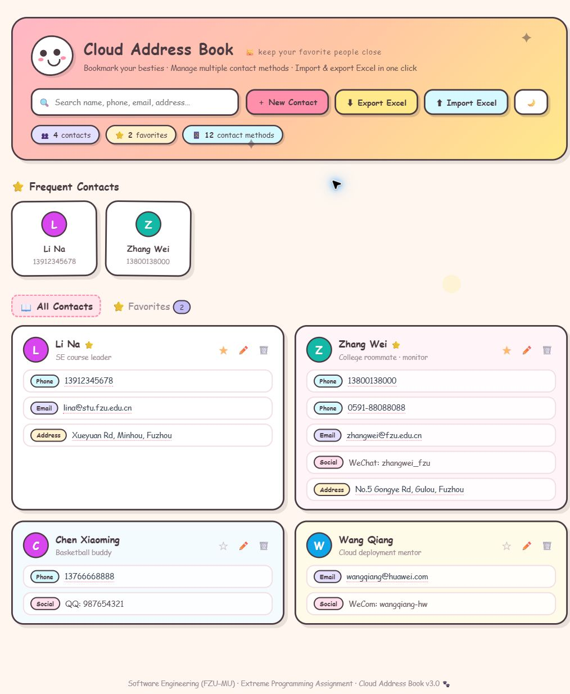
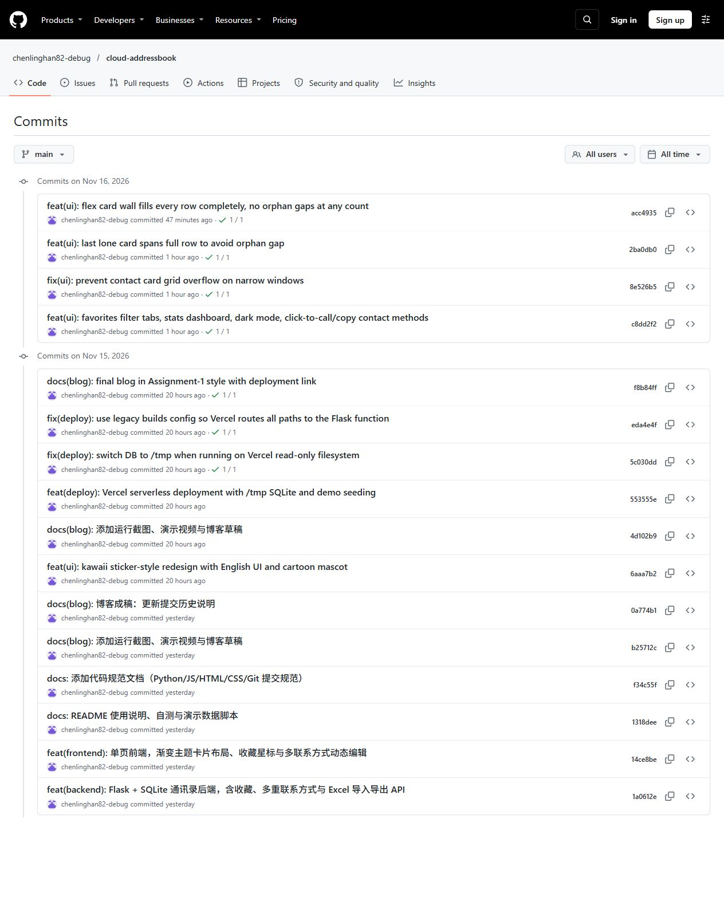

# 软件工程极限编程作业：云通讯录——陈凌晗 832401201

| 项目 | 内容 |
| --- | --- |
| 课程 | Software Engineering（FZU–MU） |
| 团队名称 | 云通讯录小组 |
| 姓名、学号 | 陈凌晗 832401201 |
| GitHub账号 | chenlinghan82-debug |
| 作业要求 | [Extreme Programming](https://bbs.csdn.net/topics/620593436) |
| 作业目标 | 实现通讯录功能并记录双人协作、测试与部署 |
| 项目仓库 | [队友原仓库](https://github.com/chenlinghan82-debug/cloud-addressbook) |
| 公网地址 | [当前v3.0](https://addressbook-zeta.vercel.app/) |
| 代码规范 | [补充分支代码规范](https://github.com/qinghanz6/cloud-addressbook/blob/codex/v3-persistence-delivery/docs/CODE_STANDARD.md) |
| 其他参考 | Flask、openpyxl、Psycopg官方文档 |
| 截止时间 | 2026年11月17日23:59 |

## 目录

1. 需求与实现
2. 双人分工与贡献
3. 截图和Git协作
4. 测试与部署
5. 演示视频状态
6. 个人PSP

## 1. 需求与实现

本次作业开发一个Web通讯录，实现收藏联系人、多种联系方式和Excel导入导出。主体由陈凌晗使用Flask、SQLite、openpyxl和原生HTML/CSS/JavaScript完成，公网v3.0增加了收藏筛选、统计面板、深色模式和拨号、邮件、地图链接。

联系人基本信息放在contacts表中，contact_details通过contact_id保存一个人的多条联系方式。收藏用favorite字段表示，点击星标后后端切换状态，前端重新显示常用联系人。

Excel导出先统计每种联系方式需要的最大列数，再生成电话1、电话2等列，每位联系人占一行。补充版把用户内容按文本写入，保留文本电话前导零，避免以等号开头的内容被Excel当作公式。导入识别姓名/Name、收藏/Favorite、备注/Notes及联系方式表头；姓名可以换列，零值不会被当成空值。导入新增联系人，不自动去重，使用模板前需删除示例行。

## 2. 双人分工与贡献

| 成员 | 工作 |
| --- | --- |
| 陈凌晗 | 原项目与v3.0主体，页面、CRUD、收藏、多联系方式、Excel初版和Vercel部署 |
| 张晴涵 | 补充任务组织、Fork协作、持久化适配、导入修复、自动测试、博客与验收材料；本轮实现与验证使用Codex协助 |
| 队友后续审查 | 陈凌晗审查PR、配置数据库并合并部署；目前尚未完成 |

按本次交付模块工作量，贡献评价为陈凌晗60%、张晴涵40%，合计100%。此为工作范围评价，不是Git提交占比，也不代表未经AI协助独立编写了全部代码。既有提交的作者和日期不变。两人提交前应复核该评价。

## 3. 截图和Git协作

原仓库基线acc4935包含陈凌晗账号16次提交。张晴涵使用qinghanz6建立Fork和codex/v3-persistence-delivery功能分支，提交真实补充修改并向队友仓库发起PR。代码修改和材料按不同提交记录，最终以PR提交列表为准，不把尚未合并的修改写成原仓库main已有的提交。

- [协作PR #1](https://github.com/chenlinghan82-debug/cloud-addressbook/pull/1)
- [张晴涵Fork功能分支](https://github.com/qinghanz6/cloud-addressbook/tree/codex/v3-persistence-delivery)
- [v3.1.0版本发布页](https://github.com/qinghanz6/cloud-addressbook/releases/tag/v3.1.0)

版本发布在张晴涵Fork，队友原仓库等待审查合并。老师要求的是仓库commit次数至少3次，PR和版本发布属于另外的交付事项。

## 4. 测试与部署

本地执行python docs/selftest.py，11项回归全部通过。GitHub Actions分别使用SQLite和独立PostgreSQL 17数据库执行同一套测试，两组均成功。

[实际CI结果](https://github.com/qinghanz6/cloud-addressbook/actions/runs/43837115241)

测试比较新增、编辑、删除、多联系方式、收藏、搜索，以及Excel往返后的姓名、备注、收藏和全部联系方式。还覆盖异常文件、上传限制、非法JSON、事务回滚和跨进程保存。Vercel缺少DATABASE_URL时返回503，不会再悄悄退回临时数据库。

原网站已经部署并可公网访问。补充版通过DATABASE_URL连接PostgreSQL，本地继续使用SQLite。陈凌晗需要先导出原数据、在Vercel配置连接，再合并PR并部署，随后用新增联系人和重新部署验证数据仍在。目前CI通过不等于原网站持久化配置完成。

## 5. 演示视频状态

本次已取得真实的当前公网首页和最新GitHub截图。完整v3.0前端操作视频尚未补成：浏览器工具因无法可靠确认Windows当前网址而停止控制。原仓库的16秒视频只覆盖部分操作，不能作为完整演示；也不能用旧版v2.1视频替代当前v3.0。

最终提交前需补录：新增联系人、多个联系方式、收藏与取消、编辑、搜索、导出并查看Excel、导入样例及核对结果。该缺项如实保留，未标为已完成。

## 6. 个人PSP

单位：小时。以下均为整理材料时的参考估计，并非计时日志；耗时列尚需本人核实，不能表述为已测量的实际耗时。

| 阶段 | 计划参考估计 | 耗时参考估计（未核实） |
| --- | ---: | ---: |
| 需求与结构设计 | 1 | 1.5 |
| 后端数据库 | 3 | 3.5 |
| 页面和交互 | 3 | 4 |
| Excel实现 | 2 | 2.5 |
| 测试修复 | 1.5 | 2 |
| 首次部署与界面迭代 | 1.5 | 2 |
| 博客材料复核 | 1 | 1.5 |
| 合计 | 13 | 17 |

## 参考资料

- [Flask](https://flask.palletsprojects.com/)
- [openpyxl](https://openpyxl.readthedocs.io/)
- [Psycopg](https://www.psycopg.org/psycopg3/docs/)
- [Vercel存储](https://vercel.com/docs/storage)
